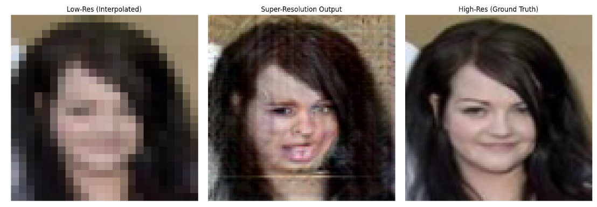
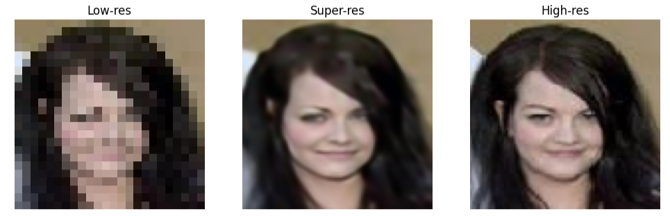
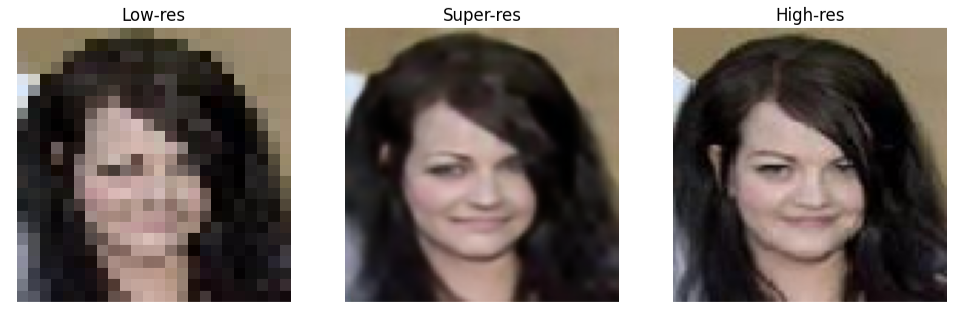

# 🧠 Face Hallucination

Low-resolution face images are a common issue in many fields, such as video surveillance systems, forensics, old photo restoration, face recognition systems, and more.

**Face Hallucination** is a type of *super-resolution*, specifically designed to restore details and increase the resolution of face images based on knowledge of facial structure.

---

## 🎯 Goal

Transform blurry or low-quality face images into high-resolution ones using knowledge about typical facial features — while **preserving the identity** of the person.

Typical input resolution: `32×24` or `16×12`
Target resolution: `96×96` or higher
> 🔥 **Main challenge:** identity and realism preservation

---

## 🛠️ Common Methods

- Traditional interpolation
- Bayesian-based approaches
- Convolutional Neural Networks (CNNs)
- Generative Adversarial Networks (GANs)

---

## 📐 Network Architectures

| Model | Description | Link |
|-------|-------------|------|
| **SRGAN** | Super-Resolution Generative Adversarial Network | [arXiv:1609.04802](https://arxiv.org/abs/1609.04802) |
| **Real-ESRGAN** | Enhanced SRGAN with real-world degradation handling | [arXiv:2107.10833](https://arxiv.org/abs/2107.10833) |
| **PULSE** | Self-Supervised Upsampling via Latent Space | [GitHub](https://github.com/alex-damian/pulse) |
| **Attention-FH** | Attention-Aware Face Hallucination | [arXiv:1708.03132](https://arxiv.org/abs/1708.03132) |
| **SRResNet** | Residual-based Super-Resolution network | [arXiv:1609.04802](https://arxiv.org/abs/1609.04802) |
| **C-Face** | Identity-aware face hallucination with a face-recognition (compare-face) loss; the "shape control" wording in earlier README versions needs verification | [JAIR 2022, doi:10.1613/JAIR.1.13816](https://doi.org/10.1613/JAIR.1.13816) |

---

## ⚠️ Responsible use

The output is a **plausible reconstruction, not a recovery of real details**. The smaller the input
(especially ×8 from 16 px), the more detail is invented. The results must not be used to identify
a person or as evidence; at most they are a hint, to be shown next to the original.

---

## 🚧 Project status

The repository is being turned into a product-ready package `facehall`. The current state and
the plan are in `docs/PROJECT.md`; decisions are in `docs/DECISIONS.md`; metrics are in
`docs/RESULTS.md`. Phases 0–4 (repository hygiene, reproducible baseline, realistic
degradations, model quality, inference pipeline) are done; Phase 5 (ONNX models, a local REST API
and Docker images) is in progress. The original notebook and weights live in `legacy/` and are
read only. The trained weights are not published.

```bash
uv sync                  # PyTorch from PyPI (CUDA build on Linux)
uv sync --extra cpu      # or: CPU-only PyTorch (then use `uv run --extra cpu ...`)
uv run pytest
uv run facehall --version
```

### Enhancing photos and videos

`facehall enhance` detects the faces of a photo or of every video frame, restores each one with
a model and pastes it back into a bicubic upscale:

```bash
uv run facehall enhance photo.jpg -o out.png --scale 4          # one photo
uv run facehall enhance photos/ -o enhanced/ --scale 8 --watermark   # a folder, visible mark
uv run facehall enhance photo.jpg -o out.png --box 120,80,18,22  # a face the detector misses
uv run facehall enhance photo.jpg -o out.png --ckpt runs/<id>/best.safetensors
uv run facehall enhance clip.mp4 -o clip_x4.mp4 --scale 4        # a video (needs ffmpeg)
```

- **Face sizes:** the models restore small faces: about 8 px between the eyes at ×4 and 4 px at
  ×8. Faces more than twice as large or as small are left to the bicubic background.
- **Marks:** every output is marked as AI-enhanced:
  - PNG text, XMP (IPTC digital source type `compositeWithTrainedAlgorithmicMedia`) and EXIF;
  - videos: container tags (MP4, MOV, MKV);
  - the model, its checksum, the parameters and the sha256 of the input;
  - no file names and no landmarks.

  `--watermark` adds a visible mark.
- **Videos** are H.264 MP4 by default, with the input's audio. Each frame is restored on its own,
  so the restored faces flicker more than the input does (see `docs/PROJECT.md`).

### Exporting a model to ONNX

```bash
uv run facehall export onnx --scale 4 -o models/x4.onnx   # the x4 reference
uv run facehall export onnx --ckpt runs/<id>/best.safetensors -o models/<name>.onnx
```

The export is checked against PyTorch and refused if the outputs differ by more than 1e-3. The
ONNX file records its source model and checksum in its metadata. `facehall enhance` runs ONNX
models through ONNX Runtime, without PyTorch:

```bash
uv run facehall enhance photo.jpg -o out.png --ckpt models/x4.onnx
uv run facehall enhance photo.jpg -o out.png --scale 8 --set models.backend=onnx   # models/x8.onnx
```

`--device cuda` needs `onnxruntime-gpu` instead of `onnxruntime`.

### A local REST API

`facehall serve` runs the ONNX models of both scales behind a small HTTP API, for local use:

```bash
uv run facehall serve                                   # http://127.0.0.1:8000, try it at /docs
curl --data-binary @photo.jpg "http://127.0.0.1:8000/enhance?scale=4" -o enhanced.png
```

- **The request body is the photo itself**, not a form. The photo is processed in memory: it is
  not written to disk and is not kept after the answer. The log holds no image data, file names,
  face boxes or face positions.
- **The answer** is marked like the output of `facehall enhance`. Its `X-Facehall-Notice` header
  repeats that the faces are a plausible reconstruction.
- **No authentication:** keep it on `127.0.0.1`.
- **Limits:** upload size, output pixels and a short queue (`serve` in
  `configs/pipeline/default.yaml`).
- **No telemetry:** ONNX Runtime sends usage telemetry to Microsoft by default, also on Linux.
  facehall turns it off (`ORT_DISABLE_TELEMETRY=1`) before ONNX Runtime is loaded. FastAPI's
  telemetry is off too.

### Docker

Two images run the same API without PyTorch: `docker/Dockerfile.cpu` and
`docker/Dockerfile.gpu`, which uses the CUDA provider of ONNX Runtime and needs the NVIDIA
Container Toolkit. They are meant to be built and used locally.

```bash
docker build -f docker/Dockerfile.cpu -t facehall:cpu .
docker run --rm -p 127.0.0.1:8000:8000 --read-only --tmpfs /tmp \
    -v "$PWD/models:/models:ro" -v "$FACEHALL_WEIGHTS/yunet:/weights/yunet:ro" facehall:cpu
```

- **No weights in the images:** mount the exported ONNX models at `/models` and the YuNet
  detector at `/weights/yunet`. Both are read-only, and the files must be readable by the
  container's user (uid 10001).
- **Keep the port on `127.0.0.1`.** The service listens on all addresses inside the container,
  and it has no authentication.
- **The GPU image** runs with `--gpus all`, and it stops at start if it finds no GPU.

---

## 📂 Dataset

🗃️ Download: [GDrive](https://drive.google.com/file/d/1Qv2c8UN87Wq2qGlyQnPEMh9kj6n87oL8/view?usp=sharing)
Collected from **FFHQ 2**, **CelebA**, and Internet sources
- `209,813` face images
- Size: `89×109` pixels

---

## 📊 Results

### 🌀 PULSE

Generated realistic but **identity-inconsistent** results:


---

### ❌ SRGAN

Performed **very poorly**, not suitable for this task:



---

### ✅ SRResNet (simplified)

Showed **the best result**. Used:
- Residual connections
- PixelShuffle (DepthToSpace)



---

### ⚙️ C-Face (simplified)

Simple encoder-decoder, no residual connections.
Performed **slightly worse** than SRResNet.



---

## 📌 Plans

🧬 **Combine SRResNet and C-Face** to leverage both residual learning and explicit shape control.
