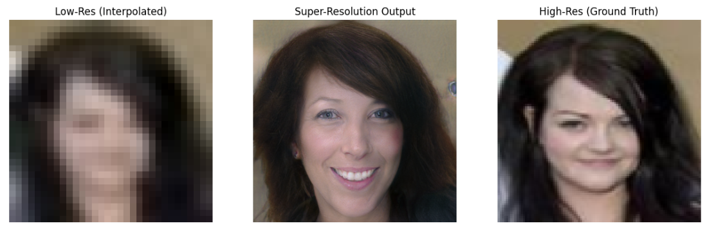

# 🧠 Face Hallucination

Low-resolution face images are a common issue in many fields, such as video surveillance systems, forensics, old photo restoration, face recognition systems, and more.

**Face Hallucination** is a type of *super-resolution*, specifically designed to restore details and increase the resolution of face images based on knowledge of facial structure.

---

## 🎯 Goal

Transform blurry or low-quality face images into high-resolution ones using knowledge about typical facial features — while **preserving the identity** of the person.

Typical input resolution: `32×24` or `16×12`
Target resolution: `96×96` or higher
> 🔥 **Main challenge:** identity and realism preservation

---

## 🛠️ Common Methods

- Traditional interpolation
- Bayesian-based approaches
- Convolutional Neural Networks (CNNs)
- Generative Adversarial Networks (GANs)

---

## 📐 Network Architectures

| Model | Description | Link |
|-------|-------------|------|
| **SRGAN** | Super-Resolution Generative Adversarial Network | [arXiv:1609.04802](https://arxiv.org/abs/1609.04802) |
| **Real-ESRGAN** | Enhanced SRGAN with real-world degradation handling | [arXiv:2107.10833](https://arxiv.org/abs/2107.10833) |
| **PULSE** | Self-Supervised Upsampling via Latent Space | [GitHub](https://github.com/alex-damian/pulse) |
| **Attention-FH** | Attention-Aware Face Hallucination | [arXiv:1708.03132](https://arxiv.org/abs/1708.03132) |
| **SRResNet** | Residual-based Super-Resolution network | [arXiv:1609.04802](https://arxiv.org/abs/1609.04802) |
| **C-Face** | Identity-aware face hallucination with a face-recognition (compare-face) loss; the "shape control" wording in earlier README versions needs verification | [JAIR 2022, doi:10.1613/JAIR.1.13816](https://doi.org/10.1613/JAIR.1.13816) |

---

## ⚠️ Responsible use

The output is a **plausible reconstruction, not a recovery of real details**. The smaller the input
(especially ×8 from 16 px), the more detail is invented. The results must not be used to identify
a person or as evidence; at most they are a hint, to be shown next to the original.

---

## 🚧 Project status

The repository is being turned into a product-ready package `facehall`. The current state and
the plan are in `docs/PROJECT.md`; decisions are in `docs/DECISIONS.md`. Phase 0 (repository
hygiene) is done; Phase 1 (reproducible baseline) is in progress. The original notebook and
weights live in `legacy/` and are read only.

```bash
uv sync                  # PyTorch from PyPI (CUDA build on Linux)
uv sync --extra cpu      # or: CPU-only PyTorch (then use `uv run --extra cpu ...`)
uv run pytest
uv run facehall --version
```

---

## 📂 Dataset

🗃️ Download: [GDrive](https://drive.google.com/file/d/1Qv2c8UN87Wq2qGlyQnPEMh9kj6n87oL8/view?usp=sharing)
Collected from **FFHQ 2**, **CelebA**, and Internet sources
- `209,813` face images
- Size: `89×109` pixels

---

## 📊 Results

### 🌀 PULSE

Generated realistic but **identity-inconsistent** results:



---

### ❌ SRGAN

Performed **very poorly**, not suitable for this task:


---

### ✅ SRResNet (simplified)

Showed **the best result**. Used:
- Residual connections
- PixelShuffle (DepthToSpace)


---

### ⚙️ C-Face (simplified)

Simple encoder-decoder, no residual connections.
Performed **slightly worse** than SRResNet.


---

## 📌 Plans

🧬 **Combine SRResNet and C-Face** to leverage both residual learning and explicit shape control.
